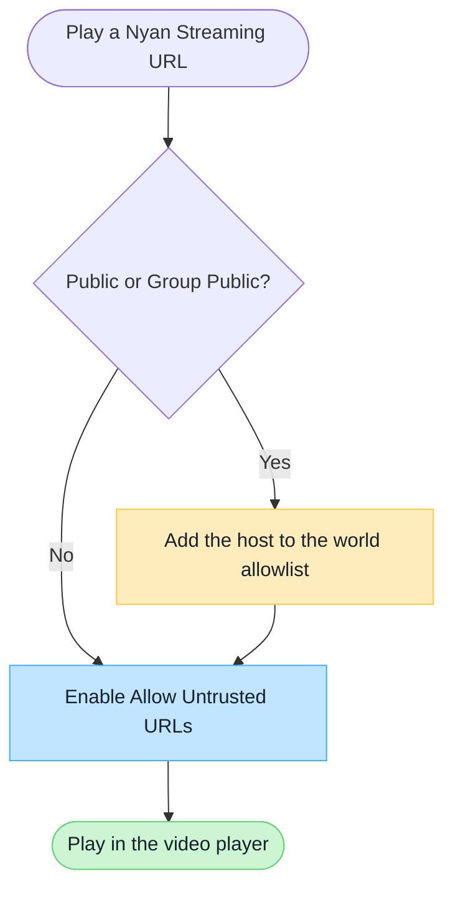

# VRChat World Domain Settings

If the host name in a Nyan Streaming playback URL is not on VRChat's default allowlist, you must configure the world and the viewer according to the instance type.

:::note[Summary]
In **Public / Group Public** instances, both the world's `Video Player Allowed Domains` list and the viewer's `Allow Untrusted URLs` setting are required. In Friends+, Group+, and other private instance types, the world does not need the domain entry, but each viewer still needs the user setting.
:::

## Requirements by Instance Type

The following applies when using a domain that is not on VRChat's default allowlist.

| Instance type           | World `Video Player Allowed Domains` | User `Allow Untrusted URLs` |
| ----------------------- | ------------------------------------ | --------------------------- |
| Public                  | **Required**                         | **Required**                |
| Group Public            | **Required**                         | **Required**                |
| Group+                  | Not required                         | **Required**                |
| Group                   | Not required                         | **Required**                |
| Friends+                | Not required                         | **Required**                |
| Friends                 | Not required                         | **Required**                |
| Invite+ / Invite        | Not required                         | **Required**                |

## Nyan Streaming Domains by Node

For Public / Group Public instances, add the host name for the node you use to `Video Player Allowed Domains`.

| Service | Host | Notes |
| --- | --- | --- |
| Nyan Streaming free server | `free.nyst.live` | For the free server; see the tools on the official site. |
| Nyan Streaming standard server | `stream.nyst.live` | Use the publishing and playback URLs shown in the dashboard. |
| Nyan Streaming Enterprise node | Custom | Custom configuration; check your agreement or dashboard for the host and conditions. |
| Nyan Streaming Japan | `stream.jp.nyst.live` | Japan service. Check the official site and Music Reports for eligible works and reporting. |

For VRChat, register the hostname from the playback URL. Check the displayed URL for custom nodes.

## Configuration Decision Flow

## Add the Domain to the World

1. Sign in to the [official VRChat website](https://vrchat.com/home/).
2. Select the target world under **My Worlds**, then open **Edit World Info**.
3. In the Nyan Streaming dashboard, find the RTSP, RTSPT, HLS, or other playback URL you will actually use.
4. Add only the URL's **host name** to `Video Player Allowed Domains`, then save the world information.
5. Verify playback in a Public or Group Public instance.

:::tip[Value to Enter]
For `rtsp://stream.example.com/organization/view-key`, enter `stream.example.com`. Do not include the scheme such as `rtsp://`, a port number, or the URL path.

Playback host names can vary by node or region. If you use URLs from multiple hosts, add each host name that the world may access.
:::

## Allow the URL for Each Viewer

Each viewer must enable `Allow Untrusted URLs` in VRChat **Settings**. If this setting is disabled, the video will not play even when the world creator has added the domain.

## If Playback Still Fails

- If playback fails only in Public / Group Public, check the world's allowed-domain entry.
- If playback fails for one user in every instance type, check that user's `Allow Untrusted URLs` setting.
- If the URL uses a short link or redirect, also verify the final host name that the player connects to.
- For player-specific low-latency settings, see [Video Player Settings / Checks](/en/services/streaming-service/nyan-streaming/video-player-settings/).

## Official VRChat Documentation

- [Video Player Allowlist](https://creators.vrchat.com/worlds/udon/video-players/www-whitelist/)
- [VRChat 2024.4.2 release notes](https://docs.vrchat.com/docs/vrchat-202442)

:::caution[VRChat May Change These Rules]
VRChat may change its allowlist and instance restrictions. Check the official documentation above when configuring your world.
:::
