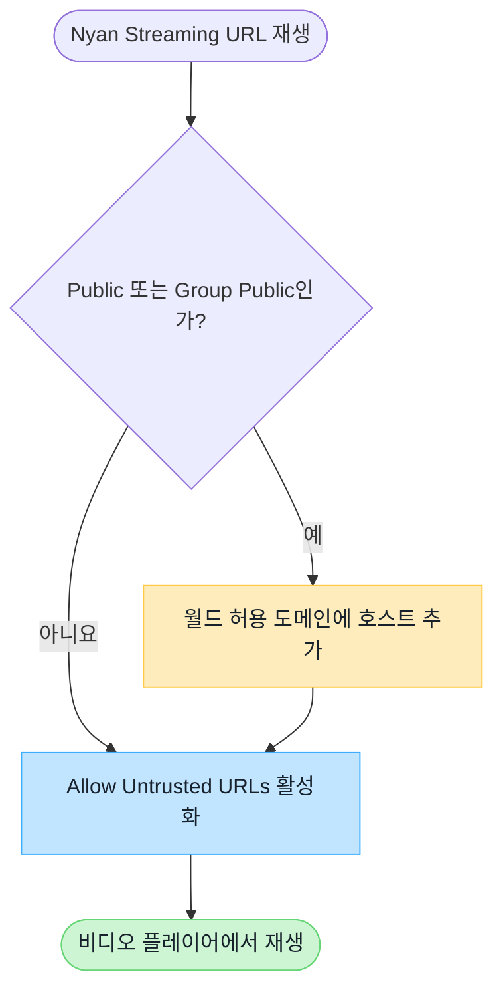

# VRChat 월드 도메인 설정

Nyan Streaming 시청 URL의 호스트 이름이 VRChat 기본 허용 목록에 없다면 인스턴스 유형에 따라 월드와 사용자 설정이 필요합니다.

:::note[요약]
**Public / Group Public**에서는 월드의 `Video Player Allowed Domains`와 시청자 측의 `Allow Untrusted URLs`가 모두 필요합니다. Friends+, Group+ 등의 비공개 인스턴스에서는 월드 측 등록은 필요하지 않지만 사용자 설정은 필요합니다.
:::

## 인스턴스 유형별 필요 설정

아래 표는 VRChat 기본 허용 목록에 없는 도메인을 사용할 때 적용됩니다.

| 인스턴스 유형          | 월드 `Video Player Allowed Domains` | 사용자 `Allow Untrusted URLs` |
| ---------------------- | ----------------------------------- | ----------------------------- |
| Public                 | **필요**                            | **필요**                      |
| Group Public           | **필요**                            | **필요**                      |
| Group+                 | 불필요                              | **필요**                      |
| Group                  | 불필요                              | **필요**                      |
| Friends+               | 불필요                              | **필요**                      |
| Friends                | 불필요                              | **필요**                      |
| Invite+ / Invite       | 불필요                              | **필요**                      |

## Nyan Streaming 노드별 도메인

Public / Group Public에서는 사용하는 노드에 따라 아래 호스트 이름을 `Video Player Allowed Domains`에 등록합니다.

| 노드   | 등록할 도메인 |
| ------ | ------------- |
| Free   | `free.nyst.live` |
| Node01 | `stream-01.nyst.live` |
| Node02 | `stream.nyst.live` |
| Node03 | 대시보드에 표시되는 시청 URL의 호스트 이름 확인 |

Node03은 접속 대상이 다를 수 있습니다. 대시보드의 스트림 키 상세에 표시되는 RTSP, RTSPT, HLS 등의 시청 URL에서 호스트 이름을 확인하세요.

## 설정 판단 흐름

## 월드에 도메인 등록하기

1. [VRChat 공식 사이트](https://vrchat.com/home/)에 로그인합니다.
2. **My Worlds**에서 대상 월드를 선택하고 **Edit World Info**를 엽니다.
3. Nyan Streaming 대시보드에서 실제로 사용할 RTSP / RTSPT / HLS 등의 시청 URL을 확인합니다.
4. URL의 **호스트 이름만** `Video Player Allowed Domains`에 추가하고 저장합니다.
5. Public 또는 Group Public 인스턴스에서 재생을 확인합니다.

:::tip[입력할 값]
`rtsp://stream.example.com/organization/view-key`라면 `stream.example.com`을 입력합니다. `rtsp://`와 같은 스킴, 포트 번호, URL 경로는 포함하지 않습니다.

시청 URL의 호스트 이름은 노드나 리전에 따라 다를 수 있습니다. 여러 호스트의 URL을 사용한다면 월드가 접속할 수 있는 각 호스트 이름을 등록하세요.
:::

## 사용자 설정 허용하기

시청자는 VRChat **Settings**에서 `Allow Untrusted URLs`를 활성화해야 합니다. 이 설정이 비활성화되어 있으면 월드 제작자가 도메인을 등록했더라도 재생할 수 없습니다.

## 재생되지 않는 경우

- Public / Group Public에서만 재생되지 않으면 월드의 허용 도메인 등록을 확인합니다.
- 모든 인스턴스 유형에서 특정 사용자만 재생되지 않으면 해당 사용자의 `Allow Untrusted URLs`를 확인합니다.
- 단축 URL이나 리디렉션을 사용한다면 플레이어가 최종적으로 접속하는 호스트 이름도 확인합니다.
- 플레이어별 저지연 설정은 [비디오 플레이어 설정/확인](/ko/services/streaming-service/nyan-streaming/video-player-settings/)을 참고하세요.

## VRChat 공식 문서

- [Video Player Allowlist](https://creators.vrchat.com/worlds/udon/video-players/www-whitelist/)
- [VRChat 2024.4.2 릴리스 노트](https://docs.vrchat.com/docs/vrchat-202442)

:::caution[VRChat 측 사양 변경]
허용 목록과 인스턴스 제한은 VRChat에서 변경될 수 있습니다. 월드를 설정할 때 위 공식 문서도 함께 확인하세요.
:::
