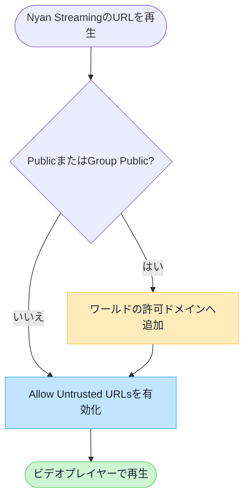

# VRChatワールドのドメイン設定

Nyan Streaming の視聴 URL に含まれるホスト名が VRChat の標準許可リストに登録されていない場合、インスタンスタイプに応じてワールド側とユーザー側の設定が必要です。

:::note[先に結論]
**Public / Group Public** では、ワールド側の `Video Player Allowed Domains` と、視聴するユーザー側の `Allow Untrusted URLs` の両方が必要です。Friends+ や Group+ などではワールド側の登録は不要ですが、ユーザー側の設定は必要です。
:::

## インスタンスタイプ別の必要設定

以下は、VRChat の標準許可リストにないドメインを使う場合の設定です。

| インスタンスタイプ      | ワールド側 `Video Player Allowed Domains` | ユーザー側 `Allow Untrusted URLs` |
| ----------------------- | ------------------------------------------ | --------------------------------- |
| Public                  | **必要**                                   | **必要**                          |
| Group Public            | **必要**                                   | **必要**                          |
| Group+                  | 不要                                       | **必要**                          |
| Group                   | 不要                                       | **必要**                          |
| Friends+                | 不要                                       | **必要**                          |
| Friends                 | 不要                                       | **必要**                          |
| Invite+ / Invite        | 不要                                       | **必要**                          |

## Nyan Streamingのノード別ドメイン

Public / Group Public で使用するノードに応じて、以下のホスト名を `Video Player Allowed Domains` へ登録します。

| ノード | 登録するドメイン |
| ------ | ---------------- |
| Free   | `free.nyst.live` |
| Node01 | `stream-01.nyst.live` |
| Node02 | `stream.nyst.live` |
| Node03 | ダッシュボードに表示される視聴 URL のホスト名を確認 |

Node03 は接続先が異なる場合があるため、ダッシュボードのストリームキー詳細に表示される RTSP / RTSPT / HLS などの視聴 URL からホスト名を確認してください。

## 設定の判断フロー

## ワールド側でドメインを登録する

1. [VRChat公式サイト](https://vrchat.com/home/)へサインインします。
2. **My Worlds** から対象のワールドを選択し、**Edit World Info** を開きます。
3. Nyan Streaming のダッシュボードで、実際に使用する RTSP / RTSPT / HLS などの視聴 URL を確認します。
4. URL の**ホスト名だけ**を `Video Player Allowed Domains` へ追加して保存します。
5. Public または Group Public のインスタンスで再生を確認します。

:::tip[登録する値]
`rtsp://stream.example.com/organization/view-key` の場合、登録する値は `stream.example.com` です。`rtsp://` などのスキーム、ポート番号、URL のパスは含めません。

視聴 URL のホスト名はノードやリージョンによって異なる場合があります。複数の視聴 URL を使う場合は、それぞれのホスト名を登録してください。
:::

## ユーザー側で許可する

視聴するユーザーは VRChat の **Settings** で `Allow Untrusted URLs` を有効にします。この設定が無効なユーザーは、ワールド側でドメインを登録していても再生できません。

## 再生できない場合

- Public / Group Public だけで再生できない場合は、ワールド側の登録を確認します。
- すべてのインスタンスタイプで再生できないユーザーは、`Allow Untrusted URLs` を確認します。
- 短縮 URL やリダイレクトを使っている場合は、最終的に接続するホスト名も確認します。
- プレイヤー固有の低遅延設定は、[ビデオプレイヤーの設定/確認](/services/streaming-service/nyan-streaming/video-player-settings/)をご覧ください。

## VRChat公式ドキュメント

- [Video Player Allowlist](https://creators.vrchat.com/worlds/udon/video-players/www-whitelist/)
- [VRChat 2024.4.2 リリースノート](https://docs.vrchat.com/docs/vrchat-202442)

:::caution[VRChat側の仕様変更]
許可リストやインスタンス制限は VRChat 側で変更される可能性があります。設定時は上記の公式ドキュメントもあわせて確認してください。
:::
