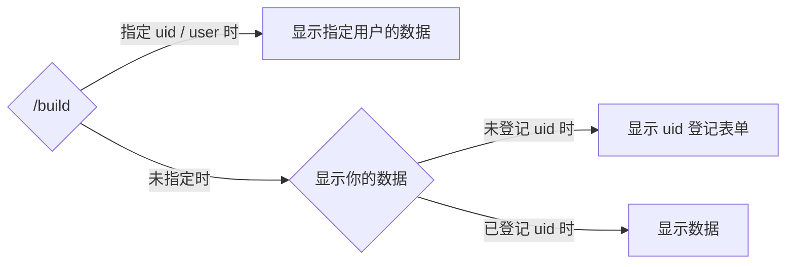

# /build
## 概述
生成《原神》的配装卡。

## 使用方法
```
/build <option>
```

选项名称 | 概述 | 是否必填
--- | --- | --
uid / user | 显示其他用户的数据。 | 否
score | 更改评分计算公式。 | 否

score 选项的值
score 选项可输入以下任一项。
- 攻击力换算
- HP 换算
- 防御力换算
- 元素充能效率换算
- 元素精通换算

## 工作流程


## 生成图像预览

