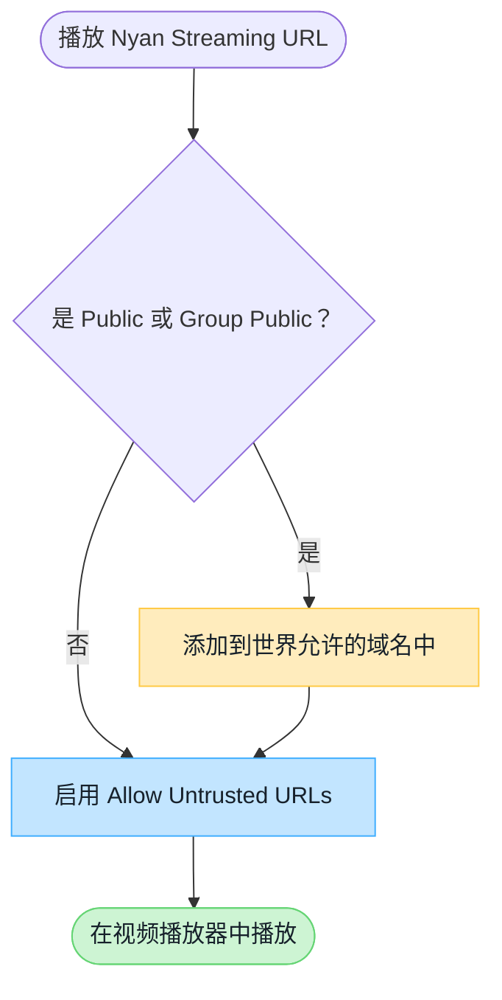

# VRChat 世界域名设置

Nyan Streaming 观看 URL 中的主机名未列入 VRChat 标准允许列表时，需要根据实例类型设置世界端和用户端选项。

:::note[所需设置概览]
**Public / Group Public** 同时需要设置世界端的 `Video Player Allowed Domains` 和观看用户端的 `Allow Untrusted URLs`。Friends+、Group+ 等无需在世界端登记域名，但仍需要用户端设置。
:::

## 各实例类型所需设置

以下设置适用于使用不在 VRChat 标准允许列表中的域名时。

| 实例类型 | 世界端 `Video Player Allowed Domains` | 用户端 `Allow Untrusted URLs` |
| --- | --- | --- |
| Public | **需要** | **需要** |
| Group Public | **需要** | **需要** |
| Group+ | 不需要 | **需要** |
| Group | 不需要 | **需要** |
| Friends+ | 不需要 | **需要** |
| Friends | 不需要 | **需要** |
| Invite+ / Invite | 不需要 | **需要** |

## 各服务的域名

在 Public / Group Public 中，请将所用服务的观看 URL 主机名登记到 `Video Player Allowed Domains`。

| 服务 | 主机 | 说明 |
| --- | --- | --- |
| Nyan Streaming 免费服务器 | `free.nyst.live` | 免费服务器的使用方法请参阅官网工具。 |
| Nyan Streaming 标准服务器 | `stream.nyst.live` | 使用控制台中显示的推流和观看 URL。 |
| Nyan Streaming Enterprise 节点 | 定制 | 采用定制配置，请在合同说明或控制台中确认主机名和使用条件。 |
| Nyan Streaming Japan | `stream.jp.nyst.live` | 日本服务。有关可用音乐和报告要求，请查看官网和音乐使用报告。 |

VRChat 中应登记观看 URL 的主机名。定制节点请以显示的 URL 为准。

## 设置判断流程

## 在世界端登记域名

1. 登录 [VRChat 官方网站](https://vrchat.com/home/)。
2. 从 **My Worlds** 选择目标世界，打开 **Edit World Info**。
3. 在 Nyan Streaming 控制台中确认实际使用的 RTSP / RTSPT / HLS 等观看 URL。
4. 将 URL 中的**主机名部分**添加到 `Video Player Allowed Domains` 并保存。
5. 在 Public 或 Group Public 实例中检查播放效果。

:::tip[应登记的值]
例如 `rtsp://stream.example.com/organization/view-key`，应登记的值为 `stream.example.com`。不要包含 `rtsp://` 等协议方案、端口号或 URL 路径。

观看 URL 的主机名可能因节点或区域而异。使用多个观看 URL 时，请分别登记其主机名。
:::

## 在用户端允许

观看用户需要在 VRChat 的 **Settings** 中启用 `Allow Untrusted URLs`。未启用该设置的用户，即使世界端已经登记域名，也无法播放。

## 无法播放时

- 仅在 Public / Group Public 中无法播放时，请检查世界端的域名登记。
- 在所有实例类型中都无法播放的用户，请检查 `Allow Untrusted URLs`。
- 使用短链接或重定向时，请同时确认最终连接的主机名。
- 播放器特有的低延迟设置请参阅[视频播放器设置与检查](/zh-hans/services/streaming-service/nyan-streaming/video-player-settings/)。

## VRChat 官方文档

- [Video Player Allowlist](https://creators.vrchat.com/worlds/udon/video-players/www-whitelist/)
- [VRChat 2024.4.2 发布说明](https://docs.vrchat.com/docs/vrchat-202442)

:::caution[VRChat 规则变更]
允许列表和实例限制可能由 VRChat 调整。设置时请同时查阅上述官方文档。
:::
