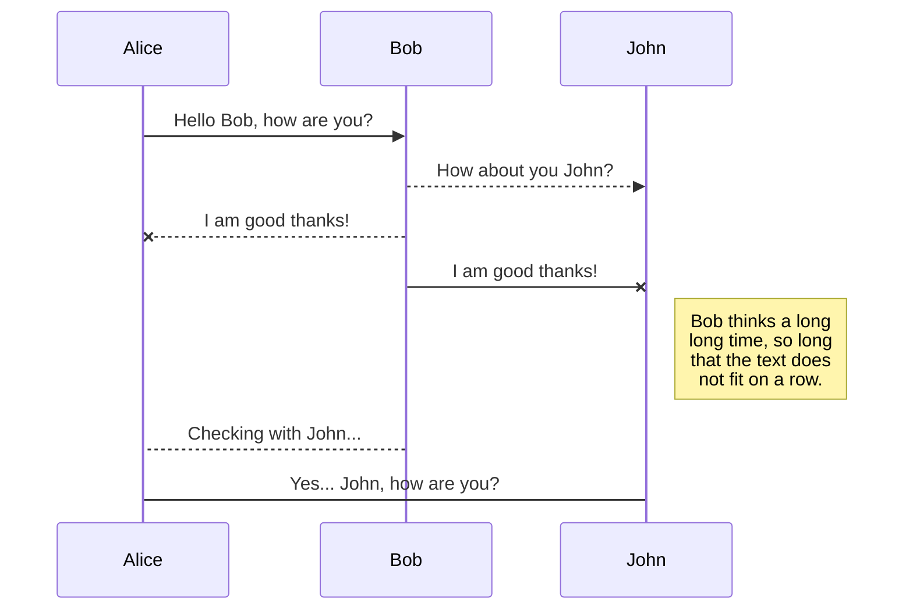

:::tip
sample
:::

:::note
sample
:::

:::caution
sample
:::

:::danger
sample
:::

> sample


---

```
sample
sample
sample
sample
```

---



---

[主页](https://krnk.org)

---

sample <kbd>CTRL</kbd> + <kbd>C</kbd>

---

斜体 *sample*

---

添加颜色 `sample`

---

# 标题 1
## 标题 2
### 标题 3
#### 标题 4
##### 标题 5
###### 标题 6

---

创建引用

这句话[^1]需要一些脚注。[^2]

[^1]: 由符合语法的词语构成的句子。
[^2]: 一个实用的例句。

---

:apple:

也可以在行内使用 :fire:

---

选项卡形式的表格

# 选项卡
## 第一个选项卡

sample

## 第二个选项卡

sample

## 第三个选项卡

sample
