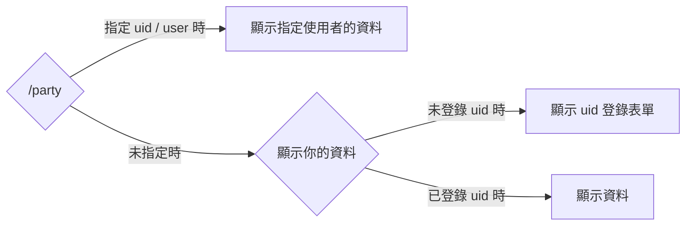

# /party
## 概述
生成《原神》的隊伍配裝卡。

## 使用方法
```
/party <option>
```

選項名稱 | 概述 | 必填
--- | --- | --
uid / user | 顯示其他使用者的資料。 | 否
score | 更改評分計算公式。 | 否

score 選項的值
score 選項可指定以下任一項。
- 攻擊力換算
- HP 換算
- 防禦力換算
- 元素充能效率換算
- 元素精通換算


## 工作流程


## 生成圖片預覽

