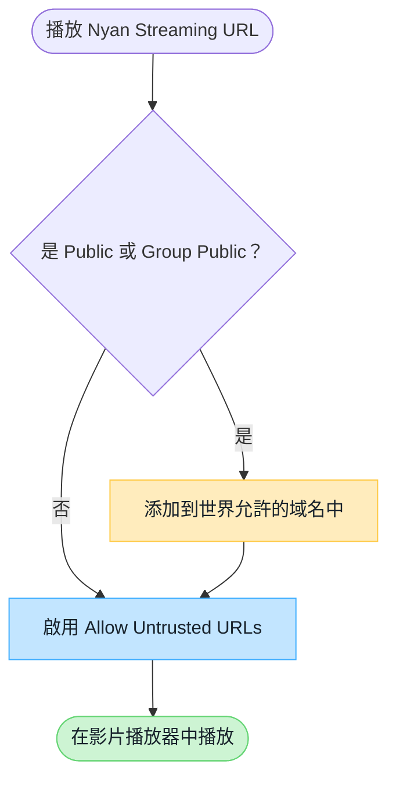

# VRChat 世界域名設定

Nyan Streaming 觀看 URL 中的主機名未列入 VRChat 標準允許列表時，需要根據實例類型設定世界端和使用者端選項。

:::note[所需設定概覽]
**Public / Group Public** 同時需要設定世界端的 `Video Player Allowed Domains` 和觀看使用者端的 `Allow Untrusted URLs`。Friends+、Group+ 等無需在世界端登記域名，但仍需要使用者端設定。
:::

## 各實例類型所需設定

以下設定適用於使用不在 VRChat 標準允許列表中的域名時。

| 實例類型 | 世界端 `Video Player Allowed Domains` | 使用者端 `Allow Untrusted URLs` |
| --- | --- | --- |
| Public | **需要** | **需要** |
| Group Public | **需要** | **需要** |
| Group+ | 不需要 | **需要** |
| Group | 不需要 | **需要** |
| Friends+ | 不需要 | **需要** |
| Friends | 不需要 | **需要** |
| Invite+ / Invite | 不需要 | **需要** |

## Nyan Streaming 各節點的域名

請根據在 Public / Group Public 中使用的節點，將以下主機名登記到 `Video Player Allowed Domains`。

| 節點 | 應登記的域名 |
| --- | --- |
| Free | `free.nyst.live` |
| Node01 | `stream-01.nyst.live` |
| Node02 | `stream.nyst.live` |
| Node03 | 查看控制台中顯示的觀看 URL 的主機名 |

Node03 的連線目標可能不同，請從控制台串流金鑰詳情中顯示的 RTSP / RTSPT / HLS 等觀看 URL 確認主機名。

## 設定判斷流程

## 在世界端登記域名

1. 登入 [VRChat 官方網站](https://vrchat.com/home/)。
2. 從 **My Worlds** 選擇目標世界，打開 **Edit World Info**。
3. 在 Nyan Streaming 控制台中確認實際使用的 RTSP / RTSPT / HLS 等觀看 URL。
4. 將 URL 中的**主機名部分**添加到 `Video Player Allowed Domains` 並保存。
5. 在 Public 或 Group Public 實例中檢查播放效果。

:::tip[應登記的值]
例如 `rtsp://stream.example.com/organization/view-key`，應登記的值為 `stream.example.com`。不要包含 `rtsp://` 等協議方案、端口號或 URL 路徑。

觀看 URL 的主機名可能因節點或區域而異。使用多個觀看 URL 時，請分別登記其主機名。
:::

## 在使用者端允許

觀看使用者需要在 VRChat 的 **Settings** 中啟用 `Allow Untrusted URLs`。未啟用該設定的使用者，即使世界端已經登記域名，也無法播放。

## 無法播放時

- 僅在 Public / Group Public 中無法播放時，請檢查世界端的域名登記。
- 在所有實例類型中都無法播放的使用者，請檢查 `Allow Untrusted URLs`。
- 使用短連結或重定向時，請同時確認最終連線的主機名。
- 播放器特有的低延遲設定請參閱[影片播放器設定與檢查](/zh-hant/services/streaming-service/nyan-streaming/video-player-settings/)。

## VRChat 官方文檔

- [Video Player Allowlist](https://creators.vrchat.com/worlds/udon/video-players/www-whitelist/)
- [VRChat 2024.4.2 發佈說明](https://docs.vrchat.com/docs/vrchat-202442)

:::caution[VRChat 規則變更]
允許列表和實例限制可能由 VRChat 調整。設定時請同時查閱上述官方文檔。
:::
