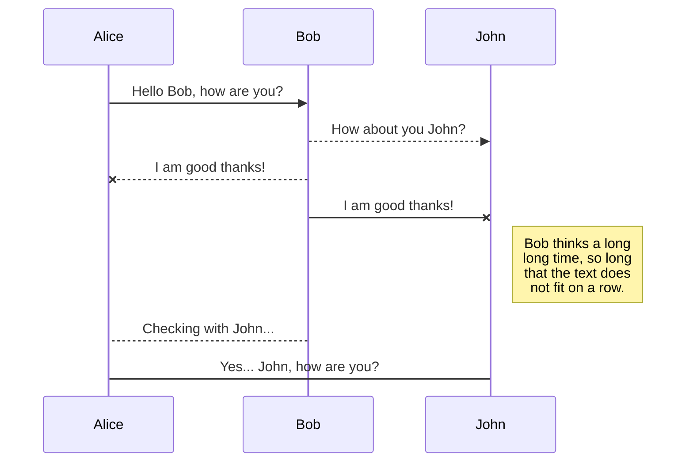

:::tip
sample
:::

:::note
sample
:::

:::caution
sample
:::

:::danger
sample
:::

> sample


---

```
sample
sample
sample
sample
```

---



---

[主頁](https://krnk.org)

---

sample <kbd>CTRL</kbd> + <kbd>C</kbd>

---

斜體 *sample*

---

新增顏色 `sample`

---

# 標題 1
## 標題 2
### 標題 3
#### 標題 4
##### 標題 5
###### 標題 6

---

創建引用

這句話[^1]需要一些腳註。[^2]

[^1]: 由符合語法的詞語構成的句子。
[^2]: 一個實用的例句。

---

:apple:

也可以在行內使用 :fire:

---

選項卡形式的表格

# 選項卡
## 第一個選項卡

sample

## 第二個選項卡

sample

## 第三個選項卡

sample
